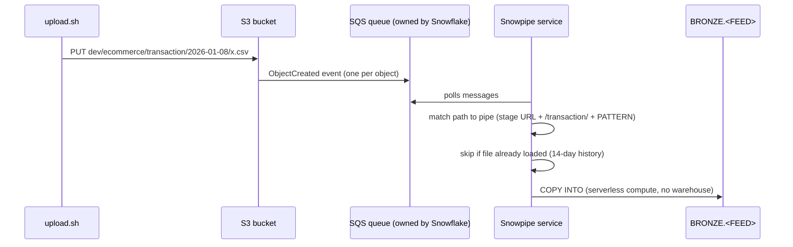

# Snowpipe ingestion: S3 file → bronze table

Builds on [Storage integration and stage](storage-integration-and-stage.md). Code: `terraform/snowflake/env/ingestion.tf`.

## 1. Two moments: deploy time vs run time

| | **Deploy time** (Terraform) | **Run time** (Snowpipe) |
|---|---|---|
| When | Push to `terraform/**` (or manual `terraform.yml` run) | Every file that lands in S3 |
| Who | GitHub Actions `terraform.yml` → `scripts/ci/tf-apply.sh` (as `TERRAFORM_SVC` / `snowflake-lab-ci`) | Snowflake's serverless Snowpipe service |
| What | Creates/updates the machinery: tables, stage, pipes, notification, procedure | Loads files with each pipe's `COPY INTO` |
| How often | Only when code changes. Re-run → *No changes* (idempotent) | Continuously, automatically |

Terraform never loads data. It builds the pipes; the pipes load the data.

## 2. What `ingestion.tf` builds

```
feeds (:19) + provenance (:48)
   ├─▶ table_ddl (:58) ─▶ CREATE OR ALTER TABLE BRONZE.<FEED>          snowflake_execute.bronze_table (:168)
   └─▶ copy_body (:64) ─▶ CREATE PIPE <FEED>_PIPE AS COPY INTO ...      snowflake_pipe.bronze (:179)
                      └─▶ RELOAD_FILES: same COPY + FORCE, then delete older loads   (:206)
pipe.notification_channel (SQS) ─▶ S3 bucket notification on dev/ecommerce/        (:193)
```

| Line | Piece | Note |
|---|---|---|
| `:19` | `feeds` | Columns + types per feed: single source of truth |
| `:48` | `provenance` | `_src_file`, `_src_row_number`, `_src_file_checksum`, `_src_file_modified`, `_loaded_at` from `METADATA$` columns |
| `:64` | `copy_body` | `COPY INTO <table> (cols) FROM (SELECT $1.., METADATA$.. FROM @stage/<feed>/) FILE_FORMAT = ...` |
| `:185` | pipe COPY | `copy_body` + `PATTERN = '.*[.]csv'` + `ON_ERROR = SKIP_FILE`; `auto_ingest = true` |
| `:193` | notification | S3 `ObjectCreated:*` on `dev/ecommerce/` → the pipes' SQS queue |
| `:252` | reload COPY | `copy_body` + `FORCE = TRUE` + `ON_ERROR = ABORT_STATEMENT` |

## 3. Run time: who is notified, who copies



- **Notified:** an SQS queue **owned by Snowflake**: one per Snowflake account/region, shared by all auto-ingest pipes. Our bucket notification points at it.
- **Routing:** every feed sends to the same queue; Snowflake picks the pipe by **path** (`transaction/…` → `TRANSACTION_PIPE`).
- **`.ctrl` files** also send events; `PATTERN = '.*[.]csv'` ignores them.

## 4. Many files at once

| Question | Answer |
|---|---|
| 10 files uploaded → how many events? | **10** (one per object). S3 may occasionally send duplicates |
| How many `COPY` runs? | Snowpipe **queues files and loads them in micro-batches** (several files per load, in parallel). Batching is not under your control. `COPY_HISTORY` always shows **one row per file** |
| Does one COPY "see" all 10 files by scanning the stage? | **No.** Snowpipe loads only files named in event messages; it never scans the stage. A file without an event is never loaded |
| Duplicate events? | Harmless: the 14-day load history prevents double loads |
| Load order? | Not guaranteed |

## 5. Adding feeds (e.g. 10 more)

1. Add 10 entries to `feeds` (`:19`). Provenance is added automatically.
2. Push → GitHub Actions runs `terraform apply` **once**: +10 tables, +10 pipes, `RELOAD_FILES` regenerated. Existing feeds: no change. Notification: no change (same queue, same prefix).
3. Upload new feeds' files **after** their pipes exist. Files already in S3 got no event → bulk `COPY INTO`, or `ALTER PIPE ... REFRESH` (files staged in the last 7 days).
4. Add dbt `sources` and models for the new feeds.

**Idempotent by design:** Terraform compares code with state, so re-running the workflow → *No changes*; nothing is created twice.

**Watch out:** changing an *existing* feed's columns makes Terraform **recreate its pipe**. Files arriving during that window can be missed → run `ALTER PIPE <FEED>_PIPE REFRESH` afterwards. The table is altered in place (`CREATE OR ALTER`), so no data is lost.

## 6. Inspect it in Snowflake

Snowsight worksheet, or `snow sql -c <conn> --role SYSADMIN`:

```sql
-- Pipes and the COPY INTO each one runs
SHOW PIPES IN SCHEMA SNOWLAB_DEV.BRONZE;                           -- definition, notification_channel (SQS ARN)
DESC PIPE SNOWLAB_DEV.BRONZE.TRANSACTION_PIPE;
SELECT GET_DDL('PIPE', 'SNOWLAB_DEV.BRONZE.TRANSACTION_PIPE');     -- full CREATE PIPE ... AS COPY INTO ...
SELECT SYSTEM$PIPE_STATUS('SNOWLAB_DEV.BRONZE.TRANSACTION_PIPE');  -- executionState, pendingFileCount, last error

-- Target tables
SELECT GET_DDL('TABLE', 'SNOWLAB_DEV.BRONZE.TRANSACTION');
DESC TABLE SNOWLAB_DEV.BRONZE.TRANSACTION;

-- What was loaded: one row per file
SELECT file_name, status, row_count, first_error_message, last_load_time, pipe_name
FROM TABLE(SNOWLAB_DEV.INFORMATION_SCHEMA.COPY_HISTORY(
  TABLE_NAME => 'SNOWLAB_DEV.BRONZE.TRANSACTION',
  START_TIME => DATEADD(day, -14, CURRENT_TIMESTAMP())))
ORDER BY last_load_time;

-- Provenance inside bronze: files, loads, checksums
SELECT _src_file, _src_file_checksum, _loaded_at, COUNT(*) AS rows
FROM SNOWLAB_DEV.BRONZE.TRANSACTION GROUP BY ALL ORDER BY _src_file;

-- Stage, file format, correction procedure
DESC STAGE SNOWLAB_DEV.LANDING.ECOMMERCE;
DESC FILE FORMAT SNOWLAB_DEV.LANDING.CSV_ECOMMERCE;
SELECT GET_DDL('PROCEDURE', 'SNOWLAB_DEV.BRONZE.RELOAD_FILES(VARCHAR, VARCHAR)');
```

UI: **Catalog → Database Explorer → SNOWLAB_DEV → BRONZE → Pipes**, and **Monitoring → Copy History**.
