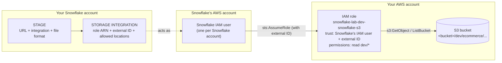

# Storage integration, IAM role and external stage

Prerequisite for any `COPY INTO` / Snowpipe work: how Snowflake gets **read access to files in your S3 bucket**.

## 1. Mental model



| Piece | One line |
|---|---|
| **Stage** | *Where* the files are (URL) and how to parse them. Stores no data |
| **Storage integration** | *Who Snowflake may become* in AWS (role ARN + external ID) and *which paths* stages may use |
| **IAM role** | *What* that identity can do in your bucket |

Snowflake never gets AWS keys. On every `LIST` / `COPY`, its own IAM user calls `sts:AssumeRole` on **your** role and receives short-lived credentials.

## 2. Key facts (common gaps)

| Question | Answer |
|---|---|
| Do I need an IAM role? | Yes (with a storage integration). It lives in **your** AWS account; **you** create it (here: Terraform via CI). Snowflake never creates anything in your account |
| What is the account in the role's "Trusted entities"? | **Snowflake's** AWS account. `DESC INTEGRATION` shows it as `STORAGE_AWS_IAM_USER_ARN = arn:aws:iam::<snowflake_aws_account>:user/<id>`. It is not your account (`aws sts get-caller-identity`) |
| Is that IAM user shared? | One user per Snowflake account, used by all its integrations. Other customers have their own users in the same Snowflake AWS account |
| What is the external ID? | A string that must match in the integration **and** the role's trust policy (`sts:ExternalId`). Stops other Snowflake customers using your role ARN (confused-deputy protection) |
| Who generates it? | Snowflake by default (read it from `DESC INTEGRATION`; it **changes if the integration is recreated**). Or you set `STORAGE_AWS_EXTERNAL_ID` yourself: stable (we use `snowflake-lab-<env>`) |
| Does `CREATE STORAGE INTEGRATION` check the role exists? | **No.** The role ARN is stored as text; AWS is first contacted on `LIST` / `COPY` |
| Does it check the bucket / prefix? | **No.** `STORAGE_ALLOWED_LOCATIONS` is a guardrail list of strings. S3 has no real folders: a prefix "exists" only while objects use it |
| Does `CREATE STAGE` validate anything? | **No.** `LIST @stage` is the first end-to-end test |
| Which comes first, AWS or Snowflake? | **Snowflake integration first**: AWS needs its output (Snowflake's IAM user ARN). The role ARN is predictable from the name you choose, so the integration can reference it before the role exists |
| Who can create what? | Integration: `ACCOUNTADMIN` (account-level object). Stage: any role with `USAGE` on the integration + `CREATE STAGE` on the schema |

## 3. Steps (new AWS + new Snowflake account)

| # | Where | Step | Output |
|---|---|---|---|
| 0 | AWS | Create bucket; **choose** role name (no command reserves it) | Role ARN string |
| 1 | Snowflake (`ACCOUNTADMIN`) | `CREATE STORAGE INTEGRATION` with that role ARN, your external ID, allowed path | Integration |
| 2 | Snowflake | `DESC INTEGRATION` | Snowflake's IAM user ARN (+ external ID) |
| 3 | AWS | Create role: trust = that user + external ID; permissions = read the path | Role exists |
| 4 | Snowflake | `GRANT USAGE ON INTEGRATION`, `CREATE STAGE`, `LIST @stage` | Working stage |

### Step 0: AWS bucket + role name

```bash
ACCT=$(aws sts get-caller-identity --query Account --output text)
BUCKET=snowflake-lab-landing-$ACCT
aws s3api create-bucket --bucket $BUCKET --region ap-southeast-2 \
  --create-bucket-configuration LocationConstraint=ap-southeast-2
aws s3api put-public-access-block --bucket $BUCKET \
  --public-access-block-configuration BlockPublicAcls=true,IgnorePublicAcls=true,BlockPublicPolicy=true,RestrictPublicBuckets=true
aws s3api put-bucket-versioning --bucket $BUCKET --versioning-configuration Status=Enabled
echo "arn:aws:iam::$ACCT:role/snowflake-lab-dev-snowflake-s3"   # role ARN for step 1 (role not created yet)
```

### Step 1: storage integration (Snowflake, `ACCOUNTADMIN`)

```sql
USE ROLE ACCOUNTADMIN;
CREATE STORAGE INTEGRATION SNOWLAB_DEV_S3_LANDING
  TYPE = EXTERNAL_STAGE
  STORAGE_PROVIDER = 'S3'
  ENABLED = TRUE
  STORAGE_AWS_ROLE_ARN = 'arn:aws:iam::<aws_account_id>:role/snowflake-lab-dev-snowflake-s3'
  STORAGE_AWS_EXTERNAL_ID = 'snowflake-lab-dev'          -- optional; omit and Snowflake generates one
  STORAGE_ALLOWED_LOCATIONS = ('s3://<bucket>/dev/');
```

### Step 2: read what AWS needs

```sql
DESC INTEGRATION SNOWLAB_DEV_S3_LANDING;
-- STORAGE_AWS_IAM_USER_ARN  -> trust policy principal (Snowflake's account)
-- STORAGE_AWS_EXTERNAL_ID   -> trust policy condition
```

### Step 3: IAM role (AWS)

```bash
cat > trust.json <<'EOF'
{"Version": "2012-10-17", "Statement": [{
  "Effect": "Allow",
  "Principal": {"AWS": "<STORAGE_AWS_IAM_USER_ARN>"},
  "Action": "sts:AssumeRole",
  "Condition": {"StringEquals": {"sts:ExternalId": "snowflake-lab-dev"}}}]}
EOF
cat > perms.json <<'EOF'
{"Version": "2012-10-17", "Statement": [
  {"Effect": "Allow", "Action": ["s3:GetObject", "s3:GetObjectVersion"],
   "Resource": "arn:aws:s3:::<bucket>/dev/*"},
  {"Effect": "Allow", "Action": ["s3:ListBucket", "s3:GetBucketLocation"],
   "Resource": "arn:aws:s3:::<bucket>",
   "Condition": {"StringLike": {"s3:prefix": ["dev/*"]}}}]}
EOF
aws iam create-role --role-name snowflake-lab-dev-snowflake-s3 --assume-role-policy-document file://trust.json
aws iam put-role-policy --role-name snowflake-lab-dev-snowflake-s3 \
  --policy-name snowflake-lab-dev-snowflake-s3 --policy-document file://perms.json
```

Read-only and one prefix: Snowflake can't write or delete in your bucket.

### Step 4: stage + test (Snowflake)

```sql
GRANT USAGE ON INTEGRATION SNOWLAB_DEV_S3_LANDING TO ROLE SYSADMIN;   -- as ACCOUNTADMIN
USE ROLE SYSADMIN;

CREATE FILE FORMAT SNOWLAB_DEV.LANDING.CSV_ECOMMERCE
  TYPE = CSV SKIP_HEADER = 1 FIELD_OPTIONALLY_ENCLOSED_BY = '"'
  EMPTY_FIELD_AS_NULL = TRUE NULL_IF = ('', 'NULL', 'null', 'N/A') TRIM_SPACE = TRUE;

CREATE STAGE SNOWLAB_DEV.LANDING.ECOMMERCE
  URL = 's3://<bucket>/dev/ecommerce/'                 -- must be inside STORAGE_ALLOWED_LOCATIONS
  STORAGE_INTEGRATION = SNOWLAB_DEV_S3_LANDING
  FILE_FORMAT = SNOWLAB_DEV.LANDING.CSV_ECOMMERCE;

LIST @SNOWLAB_DEV.LANDING.ECOMMERCE;                               -- first real test: AssumeRole + ListBucket
SELECT $1, $2, METADATA$FILENAME
FROM @SNOWLAB_DEV.LANDING.ECOMMERCE/transaction/ (PATTERN => '.*[.]csv') LIMIT 5;   -- parsing test
```

`METADATA$FILENAME` here is bucket-relative (`dev/ecommerce/transaction/2026-01-01/...csv`).

## 4. Another stage with the same settings

Inside `s3://<bucket>/dev/`: **no AWS work**, reuse the integration. In your Snowflake account, as `SYSADMIN`:

```sql
CREATE STAGE SNOWLAB_DEV.LANDING.MY_TEST_STAGE
  URL = 's3://<bucket>/dev/ecommerce/transaction/'
  STORAGE_INTEGRATION = SNOWLAB_DEV_S3_LANDING
  FILE_FORMAT = SNOWLAB_DEV.LANDING.CSV_ECOMMERCE;
LIST @SNOWLAB_DEV.LANDING.MY_TEST_STAGE;
```

- Outside `dev/` (e.g. `prod/`, another bucket): add the path to `STORAGE_ALLOWED_LOCATIONS` **and** to the IAM permissions policy.
- A hand-made stage is not in Terraform (unmanaged; dropped with the database). For a permanent one, add a `snowflake_stage_external_s3` resource.

## 5. How this repo automates it

All in `terraform/snowflake/env/ingestion.tf`, applied by GitHub Actions (`terraform.yml`) as `snowflake-lab-ci` (AWS) and `TERRAFORM_SVC` (Snowflake):

| Manual step | Code |
|---|---|
| 0: bucket | `terraform/aws/landing.tf` (bucket); `ingestion.tf` reads it (`data "aws_s3_bucket"`) |
| 0: role name / ARN, external ID | `locals`: `iam_role`, `iam_role_arn`, `external_id` |
| 1: integration | `snowflake_storage_integration_aws.landing` (provider alias `accountadmin`) |
| 2: Snowflake's IAM user | `describe_output[0].iam_user_arn` (read by Terraform) |
| 3: trust policy, role, permissions | `data "aws_iam_policy_document" "snowflake_trust"`, `aws_iam_role.snowflake_s3`, `aws_iam_role_policy.snowflake_s3` |
| 4: grant, file format, stage | `snowflake_grant_privileges_to_account_role.sysadmin_integration`, `snowflake_file_format_csv.ecommerce`, `snowflake_stage_external_s3.ecommerce` |

Terraform orders it from the references (integration → its output → role → stage) in **one apply**, because we set our own external ID.

## 6. Verify and troubleshoot

```sql
DESC INTEGRATION SNOWLAB_DEV_S3_LANDING;      -- ACCOUNTADMIN: role ARN, external ID, Snowflake IAM user, allowed locations
DESC STAGE SNOWLAB_DEV.LANDING.ECOMMERCE;     -- URL, integration, file format
SHOW GRANTS ON INTEGRATION SNOWLAB_DEV_S3_LANDING;
```
```bash
aws iam get-role --role-name snowflake-lab-dev-snowflake-s3 --query Role.AssumeRolePolicyDocument
aws iam get-role-policy --role-name snowflake-lab-dev-snowflake-s3 --policy-name snowflake-lab-dev-snowflake-s3
```

UI: Snowsight → **Catalog → Database Explorer → SNOWLAB_DEV → LANDING → Stages**; AWS console → **IAM → Roles → snowflake-lab-dev-snowflake-s3** (Trust relationships, Permissions).

| Error on `LIST` | Cause → fix |
|---|---|
| `not authorized to perform: sts:AssumeRole` | Role missing, or trust principal / external ID ≠ `DESC INTEGRATION` (e.g. integration recreated with a generated ID) |
| `Access Denied` | Permissions policy doesn't cover the stage's path |
| `location ... is not allowed` | Stage URL outside `STORAGE_ALLOWED_LOCATIONS` |
| Empty result | Access works; no objects under that prefix |

## Next

With `LIST` working: create the bronze table → test `SELECT ... FROM @stage` → `COPY INTO` → wrap it in a pipe. Next: [Snowpipe ingestion](snowpipe-ingestion.md).
